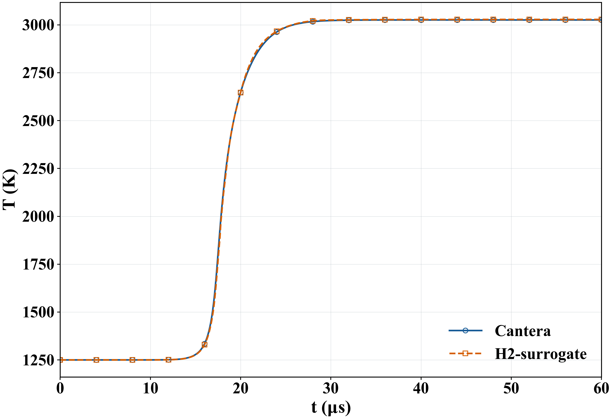
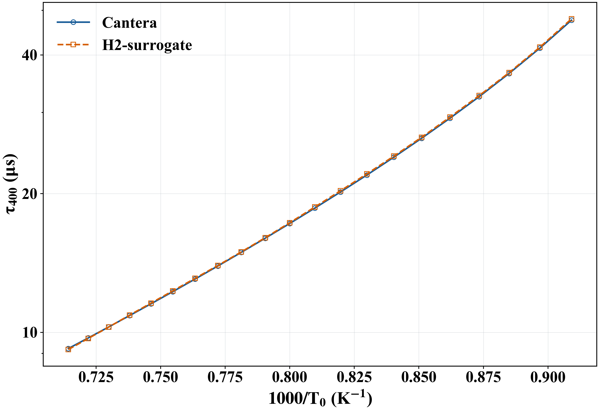

# H2-surrogate

Neural surrogate for hydrogen-air autoignition kinetics in a closed, adiabatic, constant-volume reactor. The model advances temperature, pressure and nine species mass fractions using a fixed time step of $10^{-7}$ s.

## Model

A neural network predicts the state increment in a transformed composition space. Each step applies a physical closure to recover temperature and pressure while maintaining the initial internal energy, density and elemental composition. Temperature-dependent networks represent the induction and hot reacting regimes.

$$
\mathbf{x}_{n+1}=\mathcal{C}\!\left[\mathcal{N}_{\theta}(\mathbf{x}_n;\Delta t)\right],
\qquad \mathbf{x}=[T,p,Y_1,\ldots,Y_9].
$$

Here, $\mathcal{N}_{\theta}$ is the learned one-step proposal and $\mathcal{C}$ is the physical closure. Predictions use the trained weights directly; Cantera supplies the reference trajectories for comparison.

The model covers fresh H2/air initial conditions at 1100–1400 K, 1–3 atm and equivalence ratios of 0.7–1.5, with trajectories up to 2 ms. The bundled mechanism has 9 species and 21 reactions.

## Training and physical constraints

Species mass fractions span several orders of magnitude. A Box–Cox-type transform with $\lambda=0.1$ expands the scale of trace species before input standardization:

$$
z_i=\frac{\max(Y_i,0)^{\lambda}-1}{\lambda},
\qquad \lambda=0.1.
$$

Temperature and pressure retain their physical values at this stage; the full transformed state is then standardized using the stored statistics of each temperature-dependent network. Signed increments in transformed space are scaled through an inverse hyperbolic sine, $\operatorname{asinh}(\Delta z/(\Delta t\,s))$, where $s$ is a channel-dependent scale. This compresses large positive and negative targets while retaining their signs.

Training combines adjacent-state increment supervision with short autoregressive windows of up to 50 steps (5 microseconds). Within each window, the model feeds its own physically closed predictions into the next step. The objective combines increment error, temperature and transformed-species trajectory error, and penalties for composition corrections and energy residuals.

The composition closure enforces nonnegative mass fractions, preserves the H/O elemental budgets and fixes inert N2. Intermediate species and H2O are limited by the available elemental budgets; H2 and O2 are recovered from the remaining hydrogen and oxygen. This also maintains the mass-fraction sum, to numerical precision.

Temperature is recovered from the initial specific internal energy using NASA thermodynamic polynomials. Pressure follows from the ideal-gas relation at the fixed initial density. The same differentiable closure is used during recursive training and prediction.

## Ignition comparison

At 1250 K, 2 atm and $\phi=1$, the surrogate follows the Cantera temperature history through ignition. The ignition delays are 17.290 and 17.228 microseconds, respectively.

At fixed 2 atm and $\phi=1$, a scan of 21 initial temperatures from 1100 to 1400 K gives a maximum absolute ignition-delay relative error of 0.64%. All 21 points are shown. Ignition delay is defined by the first crossing of $T=T_0+400$ K; the vertical axis is logarithmic.

These comparisons describe the selected conditions. Accuracy varies with operating conditions; the stated initial-condition range is not a uniform accuracy guarantee.

[License and provenance status](LICENSE_STATUS.md).
